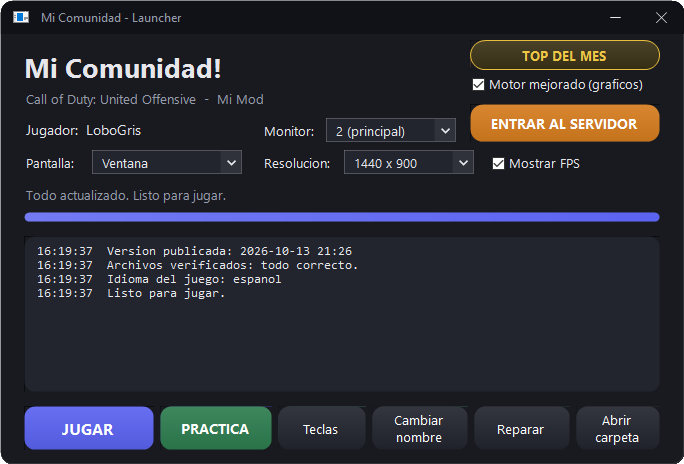
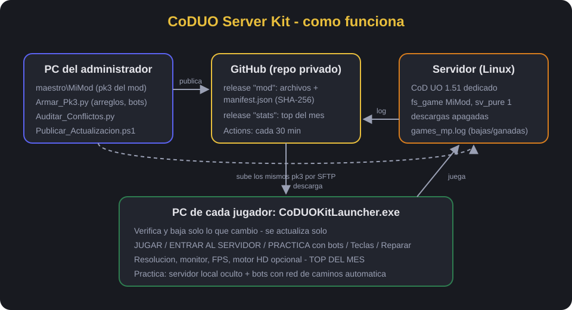
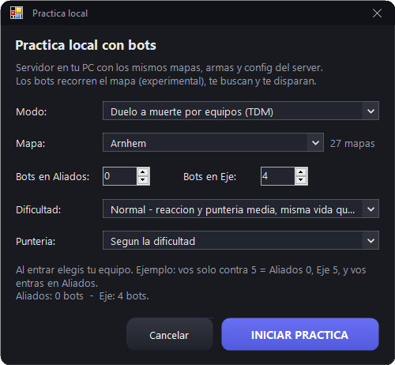
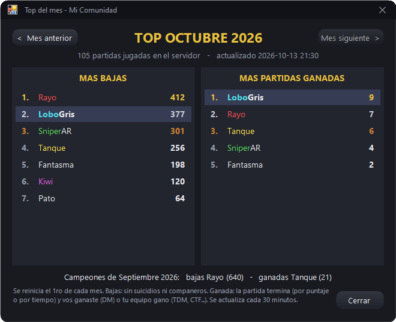
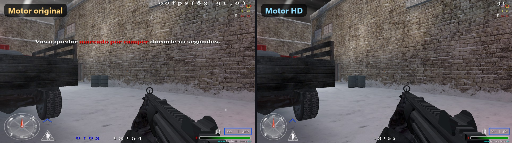
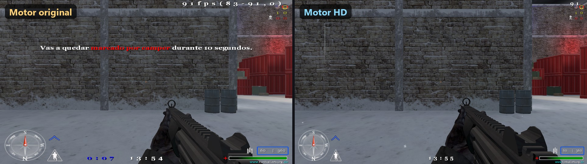
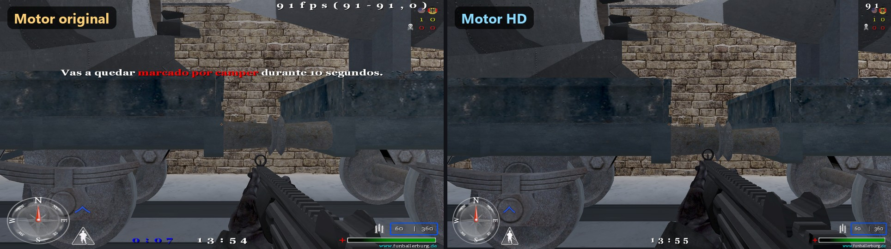
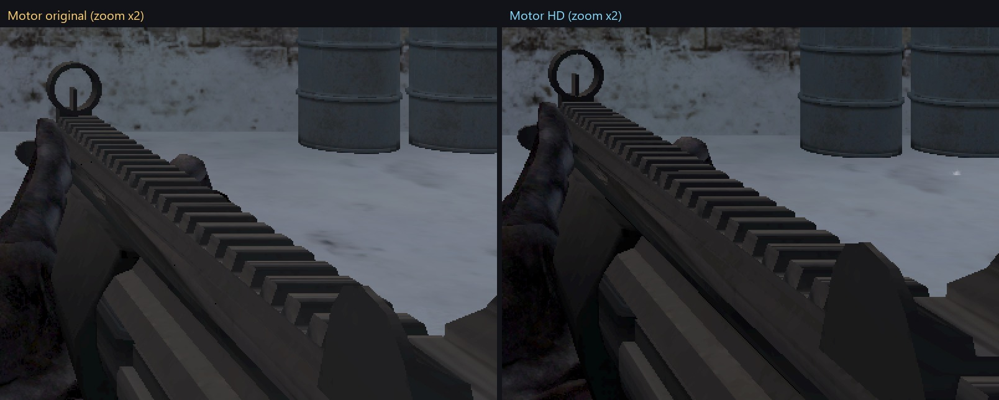
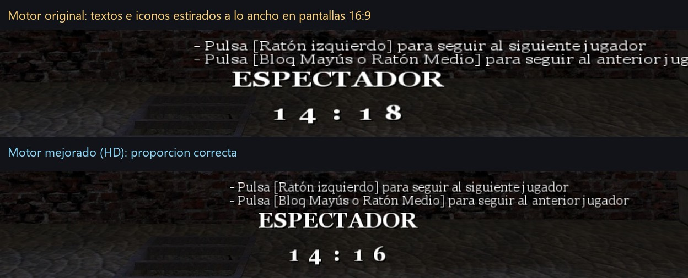
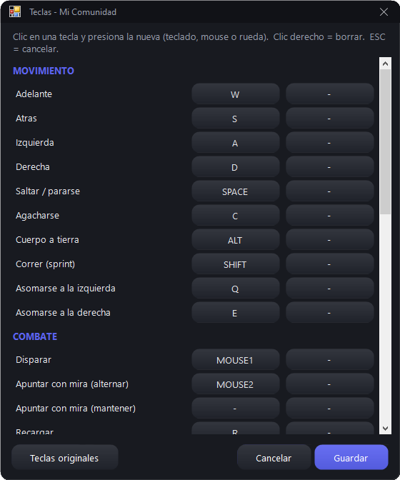

# Guía completa — CoDUO Server Kit

Esta guía explica, paso a paso, cómo montar **tu propio servidor de Call of Duty: United Offensive 1.51** con un mod, y cómo usar este kit para que tus jugadores tengan **siempre los mismos archivos** sin descargas dentro del juego, con un **launcher** que se actualiza solo, **práctica con bots**, **top del mes** y más.

Creado por **Leandro Guzman** en colaboración con un grupo de técnicos aficionados al CoD — **GERARD!, Gaston, Miguel Soldier, Guille, Jubilado, Pyro y Sr-Oscuro** — en nuestro tiempo libre, en charlas de Zoom mientras jugábamos.

> **Importante:** este proyecto **no incluye** el juego, ni mods, ni mapas, ni el motor HD. Cada comunidad pone los suyos. Solo se publica el código propio del kit (licencia GPL v3).

---

## Índice

1. [Qué es y qué resuelve](#1-qué-es-y-qué-resuelve)
2. [Cómo funciona (visión general)](#2-cómo-funciona-visión-general)
3. [Requisitos](#3-requisitos)
4. [Estructura de carpetas](#4-estructura-de-carpetas)
5. [Paso 1 — El servidor (Linux / TCAdmin)](#5-paso-1--el-servidor-linux--tcadmin)
6. [Paso 2 — La carpeta del mod (maestro)](#6-paso-2--la-carpeta-del-mod-maestro)
7. [Paso 3 — GitHub: repo privado, tokens y release](#7-paso-3--github-repo-privado-tokens-y-release)
8. [Paso 4 — Compilar y configurar el launcher](#8-paso-4--compilar-y-configurar-el-launcher)
9. [Paso 5 — Publicar actualizaciones](#9-paso-5--publicar-actualizaciones)
10. [Paso 6 — Repartir el launcher a los jugadores](#10-paso-6--repartir-el-launcher-a-los-jugadores)
11. [Práctica con bots](#11-práctica-con-bots)
12. [Top del mes (estadísticas)](#12-top-del-mes-estadísticas)
13. [Motor HD (opcional)](#13-motor-hd-opcional)
14. [Funciones del launcher](#14-funciones-del-launcher)
15. [Reglas del juego que hay que conocer](#15-reglas-del-juego-que-hay-que-conocer)
16. [Problemas conocidos y soluciones](#16-problemas-conocidos-y-soluciones)
17. [Seguridad](#17-seguridad)
18. [Tareas comunes](#18-tareas-comunes)
19. [Compilar y armar cada pieza](#19-compilar-y-armar-cada-pieza)
20. [Sumar armas, soldados y rachas de otro mod (ejemplo: Hardline)](#20-sumar-armas-soldados-y-rachas-de-otro-mod-ejemplo-hardline)

---

## 1. Qué es y qué resuelve

Un servidor de CoD UO con mod y mapas propios tiene siempre los mismos problemas:

| Problema | Cómo lo resuelve el kit |
|---|---|
| Cada jugador tiene archivos distintos y no puede entrar | El launcher compara cada archivo con una lista de huellas (SHA-256) y baja **solo lo que difiere** |
| Las descargas dentro del juego son lentas o publican tu mod | Las descargas del juego quedan **apagadas**; el launcher baja todo de un **release privado de GitHub** |
| Gente de afuera entra con tu mod | `sv_pure 1`: solo entra quien tiene los pk3 **idénticos**, y esos no son públicos |
| "Se rompió el juego" (textos `EXE_...`, modo seguro, pantalla blanca) | Botón **Reparar** y arreglos automáticos en cada arranque |
| Practicar sin servidor | **Práctica local con bots** que recorren cualquier mapa |
| Motivar a la comunidad | **Top del mes**: bajas y partidas ganadas, se reinicia cada mes |



## 2. Cómo funciona (visión general)



1. El **administrador** arma en su PC la carpeta maestra del mod (`maestro\MiMod`) con todos los pk3.
2. `Publicar_Actualizacion.ps1` sube a un **release privado de GitHub** solo los archivos que cambiaron, más un `manifest.json` con la huella de cada uno.
3. El **servidor** tiene exactamente los mismos pk3 (se suben por SFTP) y corre con `sv_pure 1` y descargas apagadas.
4. Cada **jugador** abre el launcher: baja el manifest, compara, descarga lo que falta, se actualiza solo y abre el juego con la configuración correcta.
5. Cada 30 minutos una tarea de **GitHub Actions** lee el registro de partidas del servidor y actualiza el **top del mes**.

## 3. Requisitos

**El juego**
- Call of Duty + United Offensive actualizado a **1.51** (copia original). El kit no incluye archivos del juego.

**El servidor**
- Servidor dedicado de CoD UO **1.51 para Linux** (por ejemplo un servicio con panel TCAdmin).
- Acceso **SFTP** (para subir los pk3 y para que el top del mes lea el registro de partidas).
- `game.mp.uo.i386.so` (módulo de juego Linux, viene con el servidor 1.51) **dentro de la carpeta del mod**.

**El mod**
- Tu mod en uno o más pk3. Los arreglos (`Armar_Pk3.py fixes`) y los bots de práctica están hechos para mods basados en **AWE 2.x para UO** (la mayoría de los mods populares de UO lo son). El resto del kit (launcher, publicación, top) sirve con cualquier mod.

**PC del administrador (Windows)**

| Programa | Versión | Para qué | Dónde se consigue |
|---|---|---|---|
| Windows | 7 SP1 o superior | Todo | — |
| .NET Framework | **4.8** | Compilar y usar el launcher (trae `csc.exe`; **no hace falta Visual Studio**) | Viene con Windows 10/11; para 7/8 se baja de Microsoft |
| PowerShell | 5.1 | Publicar y generar la config de práctica | Viene con Windows 10/11 (WMF 5.1 para 7) |
| Python | 3.8 o superior | Armar pk3, auditar conflictos, top del mes | python.org (marcar "Add to PATH") |
| Paquetes de Python | `paramiko`, `pynacl` | Solo el top del mes (SFTP y secretos de GitHub) | `pip install paramiko pynacl` |
| Git | cualquiera | Opcional, para versionar tu copia | git-scm.com |
| Cliente SFTP | FileZilla, WinSCP… | Subir archivos al servidor | — |

**GitHub**
- Cuenta gratis, un **repositorio privado** para tus archivos y dos tokens *fine-grained* (ver [paso 3](#7-paso-3--github-repo-privado-tokens-y-release)).

**Jugadores**
- El juego instalado, Windows 7 SP1 o superior con .NET 4.5+ (4.8 recomendado). En Windows 7 puede hacer falta instalar certificados (ver [problemas](#16-problemas-conocidos-y-soluciones)).

## 4. Estructura de carpetas

```
CoDUO-Server-Kit/
├─ launcher/            Código del launcher (C#): CoDUOKitLauncher.cs, Practica.cs, Teclas.cs, Top.cs, Ui.cs, build.bat
├─ parche/              "Parche" para reemplazar launchers viejos sin auto-actualización
├─ herramientas/        Publicar_Actualizacion.ps1, Armar_Pk3.py, Auditar_Conflictos.py, Generar_Practica_cfg.ps1
├─ practica_src/        Script de los bots (_awe_bots.gsc) -> se empaqueta en zzzzzz_kit_practica.pk3
├─ estadisticas/        Top del mes: actualizar_estadisticas.py + tarea de GitHub Actions
├─ ejemplos/            config.example.json, github.example.json, server.cfg de ejemplo
├─ docs/                Esta guía
└─ imagenes/            Capturas
```

Carpetas que **vos** creás (y que **nunca** se suben, están en `.gitignore`):

```
maestro/MiMod/          TODOS los archivos que reciben los jugadores (pk3, practica.cfg, uoconfig_mp.cfg)
maestro/Launcher/       CoDUOKitLauncher.exe.nuevo (así se auto-actualizan los launchers) y motor HD opcional
servidor/MiMod/         Copia local de server.cfg y awe.cfg del servidor
fixes_src/, armas_src/  Tus archivos propios que van dentro de pk3 (scripts arreglados, armas)
mods_terceros/          pk3 de otros mods que usa Armar_Hardline.py (nunca se publican)
privado/                github.json con tus tokens  ⚠️ NUNCA lo publiques
```

## 5. Paso 1 — El servidor (Linux / TCAdmin)

1. **Subí la carpeta del mod** (por ejemplo `MiMod`) a la raíz del juego en el servidor, al lado de `main` y `uo`, por SFTP (FileZilla, WinSCP).
2. **Obligatorio en Linux:** dentro de `MiMod` tiene que estar `game.mp.uo.i386.so` (el módulo de juego para Linux, viene con el servidor 1.51). Sin él el servidor no carga los scripts del mod.
3. Creá `MiMod/server.cfg` partiendo de [`ejemplos/server.cfg`](../ejemplos/server.cfg). Lo clave:
   ```
   set sv_pure "1"            // solo entra quien tiene los pk3 idénticos
   set sv_allowDownload "0"   // sin descargas dentro del juego
   set sv_wwwDownload "0"
   set rconpassword "CAMBIAR"  // una clave larga y propia
   ```
4. Creá `MiMod/autoexec_mp.cfg` con `exec server.cfg` (así se carga aunque el panel no lo pida).
5. **Línea de comando** del servidor (en TCAdmin: *Administrador Línea de Comando*):
   ```
   +set fs_game MiMod +exec server.cfg +map mp_harbor
   ```
   - El mapa de arranque se elige ahí; el modo, con `g_gametype` en `server.cfg`.
   - El editor de "Archivos de Configuración" de algunos paneles abre `uo/server.cfg`, que **no es** el que usa tu mod.
6. **No uses** "Sincronizar descargas rápidas" (o similar) del panel: publica todos tus pk3 en una web pública.
7. Reiniciá y revisá la consola: tiene que cargar tu mod sin `script compile error`.

> **Un error de script en Linux tira el servidor abajo.** Probá siempre los cambios primero en local (ver [práctica](#11-práctica-con-bots)) y después en el servidor con `rcon map_restart`.

## 6. Paso 2 — La carpeta del mod (maestro)

`maestro\MiMod\` es la **fuente de la verdad**: lo que haya ahí es lo que van a tener todos los jugadores y el servidor.

- Copiá ahí los pk3 de tu mod y tus mapas.
- `uoconfig_mp.cfg` (opcional): configuración inicial de teclas/video. **Solo se instala si el jugador no tiene una**, nunca pisa la suya.
- Antes de publicar, corré la auditoría de conflictos:
  ```
  python herramientas\Auditar_Conflictos.py
  ```
  Te avisa si un pk3 de mapas **pisa** archivos del mod (armas, scripts, menús). Tiene que dar `total: 0`. Ver [reglas de prioridad](#15-reglas-del-juego-que-hay-que-conocer).

`herramientas\Armar_Pk3.py` arma tus pk3 propios:

| Comando | Genera | Va al servidor |
|---|---|---|
| `python herramientas\Armar_Pk3.py fixes` | `zzzzzz_kit_fixes.pk3`: el `_awe.gsc` del mod con arreglos (estrella del anti-camper que no se iba, vida configurable con `kit_player_health`) + lo que pongas en `fixes_src\` | Sí |
| `python herramientas\Armar_Pk3.py armas` | `z_zzz_kit_armas.pk3`: lo que pongas en `armas_src\` (archivos `weapons/mp/...`) | Sí |
| `python herramientas\Armar_Pk3.py practica` | `zzzzzz_kit_practica.pk3`: bots de práctica (ver [11](#11-práctica-con-bots)) | **No** (solo jugadores) |

> `Armar_Pk3.py` está pensado para mods basados en **AWE 2.x para UO**. Editá al principio del archivo el nombre del pk3 de tu mod (`MOD`) y la carpeta del juego (`JUEGO`).

## 7. Paso 3 — GitHub: repo privado, tokens y release

1. Creá un **repositorio privado** en GitHub (por ejemplo `mi-mod`). Ahí van a vivir los releases con tus archivos (no el código del kit).
2. Creá **dos tokens** *fine-grained* (Settings → Developer settings → Personal access tokens → Fine-grained), ambos **solo para ese repo**:

   | Token | Permisos | Dónde va |
   |---|---|---|
   | **lectura** | Contents: **Read-only** | Dentro del launcher de **todos** los jugadores (`config.json`) |
   | **escritura** | Contents, Secrets y Workflows: **Read and write** | **Solo** en tu PC, en `privado\github.json` |

3. Copiá [`ejemplos/github.example.json`](../ejemplos/github.example.json) a `privado\github.json` y completalo:
   ```json
   { "owner": "TU_USUARIO", "repo": "mi-mod", "tag": "mod",
     "write_token": "github_pat_...", "read_token": "github_pat_..." }
   ```
4. El release `mod` se crea solo la primera vez que publicás.

> ⚠️ **Límite del diseño — leelo:** el token de lectura va **en texto plano** dentro del `config.json` que reciben todos los jugadores. Cualquiera que tenga el launcher puede sacarlo y bajarse **todos** tus archivos del release, y con ellos entrar a tu servidor (para `sv_pure` es igual que un jugador más). `sv_pure` + repo privado **no es una seguridad fuerte**: sirve para que no entre cualquiera, no para frenar a alguien de tu comunidad que le pase el launcher a otro. Repartí el launcher solo a gente de confianza; si se filtra, creá otro token de lectura, borrá el viejo y repartí el launcher nuevo con el parche.
>
> El token de **escritura nunca** sale de tu PC. Ponele **vencimiento** (por ejemplo 1 año) y renovalo antes de que venza. Al de lectura también podés ponerle vencimiento, pero cuando vence los launchers dejan de actualizarse hasta que les llegue uno nuevo con el parche.

## 8. Paso 4 — Compilar y configurar el launcher

1. Compilá (no hace falta Visual Studio):
   ```
   launcher\build.bat
   ```
   Genera `CoDUOKitLauncher.exe` con el compilador de .NET que trae Windows.
2. Al lado del exe va `config.json` (partí de [`ejemplos/config.example.json`](../ejemplos/config.example.json)):
   ```json
   {
     "owner": "TU_USUARIO", "repo": "mi-mod", "tag": "mod",
     "token": "github_pat_...(token de LECTURA)",
     "gameExe": "CoDUOMP.exe", "modDir": "MiMod",
     "server": "123.45.67.89:28960",
     "title": "Mi Comunidad",
     "subtitle": "Call of Duty: United Offensive  -  Mi Mod",
     "publicKey": "<RSAKeyValue>...(clave PUBLICA de firma, ver punto 5)</RSAKeyValue>"
   }
   ```
3. El launcher se instala en `<carpeta del juego>\Launcher\` (por ejemplo `C:\Juegos\Call of Duty UO\Launcher\CoDUOKitLauncher.exe`).
4. Para que se **actualice solo**: copiá el exe compilado a `maestro\Launcher\CoDUOKitLauncher.exe.nuevo` (con ese nombre) y publicá. Cada launcher baja el `.nuevo`, se renombra a sí mismo a `.viejo`, pone el nuevo y se reinicia.

> Se publica como `.nuevo` y no como `.exe` a propósito: si no, los launchers intentan sobrescribir el exe que está corriendo y Windows lo bloquea ("Acceso denegado").

5. **Firmá las actualizaciones (muy recomendado).** Sin firma, quien consiga tu token de escritura puede publicar un programa cualquiera y el launcher de **todos** tus jugadores lo bajaría y lo ejecutaría. Con firma, el launcher solo acepta la lista de archivos (`manifest.json`) firmada con **tu** clave privada, que nunca sale de tu PC:
   ```
   powershell -ExecutionPolicy Bypass -File herramientas\Generar_Claves.ps1 -Exportar E:\respaldo_clave_firma.xml
   ```
   - Crea la clave privada en `privado\firma_privada.dat`, **cifrada con tu usuario de Windows** (copiada a otra PC no sirve), y muestra la **clave pública** (`<RSAKeyValue>...`).
   - Pegá la clave pública en `config.json`, campo `"publicKey"`. Desde ahí `Publicar_Actualizacion` sube también `manifest.sig` y el launcher rechaza cualquier lista sin firma válida (en el registro dice `ACTUALIZACION RECHAZADA` y sigue con los archivos que ya tenía).
   - `-Exportar` guarda una copia **sin cifrar** de la privada: llevala a un pendrive y borrala de la PC. Si cambiás de PC, `Generar_Claves.ps1 -Importar <archivo>`. **Si la perdés**, tenés que generar otra y repartir a todos un launcher con la nueva clave pública (por el parche).
   - Para pasar a firma a jugadores que ya tienen el launcher: generá las claves, publicá el launcher nuevo (`.nuevo`) **y** el `config.json` con `publicKey` dentro de `maestro\Launcher\`. Las versiones viejas del launcher no miran la firma y se actualizan solas.
   - El launcher además rechaza cualquier ruta que intente escribir fuera de la carpeta del juego (`..`, `C:\...`).

6. **Varios servidores (opcional).** El campo `"server"` de `config.json` da un solo botón y vive en la PC de cada jugador: para cambiarlo hay que repartir el archivo de nuevo. La alternativa es publicar la lista de servidores como un archivo más: poné `maestro\Launcher\servidores.json` (partí de [`ejemplos/servidores.example.json`](../ejemplos/servidores.example.json)) y publicá:
   ```json
   [
     { "nombre": "SERVIDOR 1", "direccion": "123.45.67.89:28960" },
     { "nombre": "SERVIDOR 2", "direccion": "203.0.113.10:28960" }
   ]
   ```
   - Con dos servidores, el botón de siempre se divide en **dos botones** lado a lado, con el texto de `"nombre"` (corto: unos 12 caracteres). Pasando el mouse se ve la dirección.
   - Viaja **firmado** como el resto de la actualización: para cambiar una IP o el texto de un botón, editás el archivo y publicás. No hay que recompilar ni tocar el `config.json` de nadie.
   - Sin `servidores.json`, todo sigue como antes (un botón con `"server"`). Direcciones con caracteres raros se ignoran.
   - **Servidor en tu casa:** si el servidor 2 está en tu red, desde esa misma red no se entra con la IP pública salvo que el router haga *hairpin NAT* (también llamado *NAT loopback*). Sin eso, desde tu casa usá la IP interna (`connect 192.168.x.x`).

## 9. Paso 5 — Publicar actualizaciones

```
herramientas\Publicar_Actualizacion.bat
```

- Calcula la huella de cada archivo de `maestro\`, sube **solo los que cambiaron** (con 3 reintentos si se corta), borra del release lo que ya no está y sube el `manifest.json` **al final** (así ningún launcher ve una lista a medias).
- Si cambiás un pk3 que también usa el servidor: subilo al servidor y reiniciá **antes** de publicar.
- La práctica usa la misma configuración que el servidor: si cambiás `server.cfg` o `awe.cfg`, corré `herramientas\Generar_Practica_cfg.ps1` (lee `servidor\MiMod\`) y publicá.

## 10. Paso 6 — Repartir el launcher a los jugadores

Opciones:
- **Zip** con la carpeta `Launcher\` (exe + `config.json`) para descomprimir dentro de la carpeta del juego.
- **Parche** (`parche\build_parche.bat`): un exe chico que detecta la carpeta del juego (por el registro o "Buscar...") e instala/reemplaza el launcher. Útil para launchers viejos.
- Un **instalador propio** (por ejemplo con Inno Setup) — no incluido, porque normalmente incluiría el juego, que es comercial.

## 11. Práctica con bots



El botón **PRÁCTICA** levanta un **servidor dedicado oculto** en `127.0.0.1:28961` con bots y conecta el juego (un "servidor + jugador" en un solo proceso se cuelga en algunos mapas). Al cerrar el juego, apaga el servidor.

Los bots (`practica_src\maps\mp\gametypes\_awe_bots.gsc`, basado en el de AWE):

- **Red de caminos automática para cualquier mapa**: al cargar el mapa exploran el terreno desde los puntos de aparición con una grilla de 120 unidades usando `bullettrace` (piso, escalones de hasta 36, paredes, techos bajos y saltos hacia abajo de hasta 200, en un solo sentido). Hasta 3000 nodos, repartido en ~300 trazados por cuadro: un mapa grande tarda ~20 s, uno chico ~3 s, y mientras tanto ya caminan. No hace falta grabar recorridos a mano.
- **Rutas** con búsqueda en anchura; el 80% de las veces van a buscar al jugador humano.
- **Movimiento suave**: el bot va enganchado (`linkto`) a un punto que se desliza (`moveto`) — idea de MeatBot.
- **Animación de caminar**: mientras camina lleva un arma especial `bwalk_<arma>` (copia del arma sin cargador) y el `playeranim.script` le pone la pose de correr; al ver un enemigo cambia a su arma real. `Armar_Pk3.py practica` genera esas armas y el `playeranim.script` a partir de tu juego y tu mod.
- Dificultad, puntería, bots por equipo y vida configurables desde la ventana de práctica.

Diagnóstico: `+set awe_bots_debug 1` → líneas `BOTDBG` en `games_mp.log`. El registro también muestra `KIT NAV <mapa> nodos=... ms=...`.

Límites: `bullettrace` no ve las paredes invisibles (*playerclip*) y los bots no suben escaleras de mano.

## 12. Top del mes (estadísticas)



- El servidor anota cada muerte (`K;`) y los ganadores de cada partida que termina por puntaje o tiempo (`W;`) en `games_mp.log`.
- `estadisticas\actualizar_estadisticas.py` lee **solo lo nuevo** del registro por SFTP, suma por mes y publica `estadisticas.json` en un release aparte, `stats`.
  - **Bajas**: sin suicidios, sin muertes por "el mundo", sin matar compañeros.
  - **Ganadas**: en DM +1 al ganador; en equipos +1 a cada jugador del equipo ganador. Las partidas cortadas por votación no tienen ganador.
  - Los nombres cuentan **exactos** (con colores).
  - El registro no tiene fechas: lo nuevo se cuenta en el mes en que se lee.
- El launcher lo muestra en **TOP DEL MES** (con los colores de los nombres) y se reinicia solo cada mes.

**Configuración (una vez):**
1. Copiá `estadisticas\estadisticas.yml` a `.github/workflows/estadisticas.yml` **de tu repo privado** y `actualizar_estadisticas.py` a `estadisticas/` del mismo repo (`python estadisticas\subir_a_github.py` lo hace por vos).
2. Guardá la clave SFTP como secretos cifrados del repo:
   ```
   set SFTP_USER=usuario
   set SFTP_PASS=clave
   python estadisticas\poner_secretos.py
   ```
3. Ajustá en el `.yml` (o como variables) `SFTP_HOST`, `SFTP_PORT` y `LOG_PATH` (la ruta de `games_mp.log` en tu servidor; en TCAdmin suele estar en `<servidor>/.callofduty/MiMod/games_mp.log`).
4. **Huella del servidor (recomendado):** la primera corrida muestra en el registro de Actions `AVISO: ... SFTP_HOSTKEY: SHA256:...`. Guardala como secreto (`set SFTP_HOSTKEY=SHA256:...` y otra vez `poner_secretos.py`). Desde ahí, si alguien se hace pasar por tu servidor, la tarea **frena sin mandar la contraseña**. Si cambiás de servidor, actualizá el secreto.

GitHub lo corre cada 30 minutos, gratis, aunque tu PC esté apagada. Si cambiás la clave SFTP, volvé a correr `poner_secretos.py`. Lo ideal es que el usuario SFTP de esta tarea **solo pueda leer** el registro (si tu panel permite subusuarios).

## 13. Motor HD (opcional)

El launcher puede cambiar entre el **motor original** y un **motor alternativo** de 64 bits (por ejemplo "Open CoD:UO 1.51", de su autor *brague* — **no incluido**; conseguilo de su autor y respetá sus condiciones). Se activa con la casilla **Motor mejorado**; el launcher guarda los archivos originales y los restaura al destildarla.

**Qué se nota** (Mini Harbor, mismo lugar, mismo ángulo y la misma configuración, con el brillo tal como se ve en el monitor):

- Con el motor original, en pantallas 16:9 **toda la imagen sale estirada a lo ancho** (escena, arma e interfaz). Con el HD se ve con la **proporción correcta y más campo de visión**.
- El arma y los objetos cercanos se ven **más definidos**.
- Jugando se nota además en la **luz y los colores**.







> Para comparar con capturas, sacalas de la pantalla (no con el comando de captura del juego, que guarda la imagen antes del ajuste final) y tené en cuenta que el motor original aplica el brillo en el monitor.
Además: elegir **monitor**, brillo aplicado **dentro del juego** (no cambia el brillo del monitor), lectura del mouse directa (*raw input*), mejor manejo de ventana y resolución. Solo funciona en Windows de **64 bits**; en 32 bits la casilla no aparece.

## 14. Funciones del launcher

| Botón / opción | Qué hace |
|---|---|
| **JUGAR** | Abre el juego con el mod |
| **ENTRAR AL SERVIDOR** / **SERVIDOR 1 y 2** | Abre el juego y se conecta directo (dos botones si publicás `servidores.json`, ver [paso 4](#8-paso-4--compilar-y-configurar-el-launcher)) |
| **PRÁCTICA** | Servidor local con bots (modo, mapa, bots por equipo, dificultad, puntería) |
| **TOP DEL MES** | Ranking mensual de bajas y partidas ganadas |
| **Teclas** | Editor de teclas (lee/escribe los `bind` de `uoconfig_mp.cfg`) |
| **Reparar** | Vuelve a verificar/bajar todo, borra la marca de "Modo Seguro" y opcionalmente restablece el video (guarda copia) |
| **Pantalla / Resolución / Monitor / Mostrar FPS** | Se sincronizan con el juego: gana donde se cambió por última vez |
| **Motor mejorado** | Cambia al motor HD y vuelve al original |

Además, en cada arranque:
- Borra la marca `__CoDUOMP` (evita el cartel de "Modo Seguro").
- Fuerza el **idioma** correcto (`cl_language`; ver [problemas](#16-problemas-conocidos-y-soluciones)).
- La **primera vez** abre el juego con `r_swapInterval 0` (cargas de mapa ~5 veces más rápidas) y texturas en calidad completa. Después respeta lo que cada uno elija en el menú de gráficos del juego (antes se forzaba en cada arranque y pisaba esos cambios).
- Restaura el **brillo del monitor** si el juego se cierra mal.
- Le da el **foco** a la ventana del juego (si no, el mouse no responde en la práctica).
- **Limpia lo que sobra** (todo queda anotado en `launcher.log`):
  - **`server-cache` del motor HD**: ese motor copia todos los pk3 de cada servidor a `server-cache\<servidor>\` (una copia más por cada versión que publicás: en una PC llegó a 1,3 GB) y guarda ahí otra `uoconfig_mp.cfg`, así que lo que se cambiaba jugando no aparecía en la configuración general. Con el launcher no hace falta: lo apaga (`+set cl_serverCache 0`), pasa a la configuración general la de `server-cache` si es más nueva (copia: `uoconfig_mp.cfg.antes_server_cache`) y borra la carpeta y `uoservercache.dat`.
  - **`_cuarentena`**: borra las versiones viejas de **tus** pk3 (por el comienzo del nombre: `PrefijosPropios` en `CoDUOKitLauncher.cs`). Lo que no es tuyo (algo que puso el jugador) queda ahí.
  - **`uo\`**: borra los pk3 **idénticos** (mismo nombre y huella SHA-256) a uno de tu lista que está en la carpeta del mod: las copias que dejaban las instalaciones viejas.
  - **Carpetas vacías** de servidores viejos en la carpeta del juego (nunca `main`, `uo`, `miles`, `pb`, `Docs`, `UODocs`, `_Redist`, `Launcher` ni la del mod).
  - `launcher.log`: si pasa 1 MB, deja las últimas 2000 líneas.



Diseño: ventanas sin la barra de Windows, bordes redondeados, botones redondeados, desplegables oscuros. Solo WinForms + GDI+ de .NET 4: **anda en Windows 7**.

## 15. Reglas del juego que hay que conocer

- **Prioridad de pk3**: dentro de una carpeta, el juego ordena los nombres **en mayúsculas, de mayor a menor**, y el **primero gana**. `_` (95) vale más que las letras (`Z` = 90): por eso `z_zzz_kit_armas.pk3` gana a todo. La carpeta del mod gana sobre `uo\` y `main\`.
- **Un pk3 de un mapa no es solo de ese mapa**: sus archivos (armas, scripts, menús) aplican a **todos** los mapas. Un pack de mapas puede convertir un rifle en lanzacohetes en todo el servidor. Por eso existe `Auditar_Conflictos.py`.
- **sv_pure** compara las huellas de los pk3 del servidor; los pk3 extra del jugador se ignoran (por eso el pk3 de práctica no molesta online).
- **Errores de script en Linux tiran el servidor**. Archivos de armas que en Windows andan pueden tirar el servidor Linux en `map_restart`: probá en los dos.
- **Máximo 127 archivos de armas** en total (juego + mod + pk3 de práctica). Si te pasás: `Max number of weapons allowed is 127, found N`.
- **Armas nuevas en Linux**: tienen que llamarse con un prefijo que quede **después** de todas las armas del juego en orden alfabético (por ejemplo `zhl_`). Con otro prefijo el servidor Linux puede no arrancar aunque en Windows ande. Detalles en [§20.5](#205-reglas-del-motor-que-descubrimos).
- **GSC (scripts de CoD)**: no existen `int()` ni `issubstr()`; `println` no escribe sin modo desarrollador (usá `logprint`). Los nombres de variables **no distinguen mayúsculas** (`G` y `g` son la misma).

## 16. Problemas conocidos y soluciones

| Síntoma | Causa | Solución |
|---|---|---|
| Textos `EXE_CONNECTINGTO`, `EXE_AWAITINGGAMESTATE` | El juego volvió `cl_language` a inglés (pasa al cambiar de placa de video: aplica la "configuración óptima") y solo están los textos en otro idioma | El launcher corrige `seta cl_language` y pasa `+set cl_language` en cada arranque. Español = 4 |
| Cartel "¿Ejecutar en Modo Seguro?" | Quedó el archivo oculto `__CoDUOMP` de un cierre anterior | El launcher lo borra; botón **Reparar** |
| Cargas de mapa de 20 segundos | Sincronización vertical (`r_swapInterval 1`) | El launcher abre con `r_swapInterval 0` |
| "La operación requiere elevación" | Windows puso `CoDUOMP.exe` en modo compatibilidad XP | El launcher abre todo a través del shell |
| Monitor "todo blanco" | El juego cambia el brillo del monitor y no lo devuelve si se cierra mal | El launcher restaura el brillo al cerrarse el juego |
| En la práctica el mouse no responde | La ventana del juego queda sin foco (el permiso de foco se lo lleva el servidor oculto) | El launcher le da el foco con `AttachThreadInput` |
| "Cliente impuro detectado" | Alguien cambió un pk3 en el servidor o en el jugador | Igualar los archivos; en el jugador, **Reparar** |
| Windows 7: no instala .NET 4.8 ("cadena de certificados") | Faltan certificados raíz de Microsoft | Instalar los certificados raíz (2010/2011) y la actualización KB4474419 (SHA-2) |
| Windows 7: el launcher no conecta con GitHub | Faltan certificados raíz actuales (Sectigo / ISRG) | Instalar esos certificados raíz |
| Algunos mapas tiran error al cargar | Errores en los propios scripts del mapa | La práctica permite excluirlos (lista en `Practica.cs`) |
| Mapas **repetidos** en la lista del juego (con dos nombres) | El mapa está en la lista general (`mp/CoDmaps.arena`) y además en su propio `.arena` | `python herramientas\Anular_Arenas_Repetidas.py` y después `Armar_Pk3.py armas` (pisa los `.arena` propios con archivos vacíos; no toca los mapas) |

## 17. Seguridad

**Qué protege el kit y qué no.** `sv_pure` + repo privado deja afuera a quien no tiene tus archivos, pero **no** a quien consiga tu launcher (ver el aviso del [paso 3](#7-paso-3--github-repo-privado-tokens-y-release)). La firma de las actualizaciones protege a tus jugadores aunque te roben el token de escritura.

**Lista de control:**
- **Nunca** publiques `privado\` (tokens y clave de firma), tu `server.cfg` real (tiene la clave rcon) ni tus pk3.
- El token del launcher tiene que ser **solo de lectura** y **solo de tu repo**. El de escritura, con **vencimiento**.
- **Firmá** las actualizaciones (`Generar_Claves.ps1` + `publicKey`, [paso 4](#8-paso-4--compilar-y-configurar-el-launcher)) y guardá el respaldo de la clave privada **fuera** de la PC.
- Top del mes: guardá la **huella del servidor** (`SFTP_HOSTKEY`, [§12](#12-top-del-mes-estadísticas)). La tarea de Actions usa acciones fijadas a un commit exacto y versiones fijas de Python: si las actualizás, hacelo a mano y a conciencia.
- Activá la **verificación en dos pasos** en GitHub y en el panel del servidor. En el repo privado: *Settings → Code security* → **Secret scanning** y **Push protection**.
- Usá claves **largas y distintas** para SFTP, panel y rcon. El rcon del juego viaja **sin cifrar**: no uses la misma clave en otro lado. Cambialas si las compartiste.
- Si alguien publicó tus pk3 (por ejemplo, por una "descarga rápida" del panel): cambiá un archivo dentro de un pk3 tuyo (por ejemplo un `.txt` cualquiera en `armas_src\`), rearmalo, subilo y publicá. La copia filtrada queda vieja y `sv_pure` la rechaza.
- El launcher y el motor HD **no están firmados digitalmente** (Windows puede avisar). Para comprobar que un zip descargado es el original, compará su huella con la que figura en las notas del *Release*: `certutil -hashfile archivo.zip SHA256`.
- ¿Encontraste una vulnerabilidad en el kit? Ver [SECURITY.md](../SECURITY.md).

## 18. Tareas comunes

| Quiero… | Pasos |
|---|---|
| Cambiar el daño de un arma | Copiar `weapons/mp/<arma>` a `armas_src\weapons\mp\`, editar → `Armar_Pk3.py armas` → probar en local → subir al servidor + reiniciar → publicar |
| Cambiar la configuración del servidor | Editar `servidor\MiMod\server.cfg` / `awe.cfg` → subir → reiniciar → `Generar_Practica_cfg.ps1` → publicar |
| Agregar un mapa | Copiar el pk3 a `maestro\MiMod` y al servidor → agregarlo a tu `mp/CoDmaps.arena` → `Anular_Arenas_Repetidas.py` + `Armar_Pk3.py armas` → `Auditar_Conflictos.py` (total 0) → reiniciar → publicar |
| Actualizar el launcher | `launcher\build.bat` → copiar a `maestro\Launcher\CoDUOKitLauncher.exe.nuevo` → publicar |
| Sumar las armas, soldados y rachas de Hardline | Los 4 pk3 de Hardline en `mods_terceros\` → `Armar_Pk3.py armas` → `Armar_Hardline.py` → probar en local → subir al servidor + reiniciar → leer la consola → publicar ([§20](#20-sumar-armas-soldados-y-rachas-de-otro-mod-ejemplo-hardline)) |
| Cambiar el anti-camper | En `awe.cfg`: `awe_anticamp_time` (segundos quieto) y `awe_anticamp_marktime` (duración de la marca) |

## 19. Compilar y armar cada pieza

Todo se hace en Windows, desde la carpeta del proyecto (abrí una consola ahí: en el Explorador, escribí `cmd` en la barra de dirección). **Orden recomendado la primera vez:** launcher → parche → pk3 de arreglos → pk3 de armas → pk3 de práctica → (opcional) pk3 de Hardline → config de práctica → auditoría → publicar → top del mes.

### 19.1 Launcher

```
launcher\build.bat
```

- **Necesita:** .NET Framework 4.8. El script busca solo el compilador (`csc.exe`) de 64 o 32 bits.
- **Genera:** `launcher\CoDUOKitLauncher.exe` (un solo exe, sin dependencias).
- **Para usarlo:** copialo a `<carpeta del juego>\Launcher\` junto con un `config.json` (partí de `ejemplos\config.example.json`).
- **Ícono (opcional):** si querés un ícono, agregá `/win32icon:mi_icono.ico` a la línea de `csc` en `build.bat`.
- **Para que se actualice solo en los jugadores:** copialo a `maestro\Launcher\CoDUOKitLauncher.exe.nuevo` y publicá (ver 19.9).

### 19.2 Parche (instalar o reemplazar el launcher)

```
parche\build_parche.bat
```

- **Necesita:** el launcher compilado antes (19.1). El parche lo lleva adentro.
- **Genera:** `Output\Parche_Launcher_CoDUOKit.exe`.
- **Qué hace al ejecutarlo:** busca la carpeta del juego (registro de Windows, o "Buscar..."), cierra el launcher si está abierto y pone el nuevo. Pide permisos de administrador solo si la carpeta lo requiere.
- **Ojo:** el parche no trae `config.json`. Sirve para actualizar launchers que ya tienen uno, o lo repartís junto.

### 19.3 pk3 de arreglos (servidor y jugadores)

```
python herramientas\Armar_Pk3.py fixes
```

- **Necesita:** el pk3 de tu mod (basado en AWE) en `maestro\MiMod\`. Editá al principio de `Armar_Pk3.py` el nombre del pk3 (`MOD`) y la carpeta del juego (`JUEGO`).
- **Toma:** el `_awe.gsc` de tu mod y le aplica arreglos (la estrella del anti-camper que quedaba para siempre, mensajes en español, vida configurable con `kit_player_health`). También mete todo lo que pongas en `fixes_src\` (scripts propios, por ejemplo `fixes_src\maps\mp\...`).
- **Genera:** `maestro\MiMod\zzzzzz_kit_fixes.pk3`.
- **Después:** subilo al servidor, reiniciá y probá con `rcon map_restart`. Un error de script en Linux tira el servidor.
- Si tu versión de AWE es distinta, puede que algún arreglo no encuentre el texto a reemplazar: el script avisa con `esperaba 1 coincidencia(s)` y no genera nada. Ajustá o comentá ese arreglo.

### 19.4 pk3 de armas (servidor y jugadores)

```
python herramientas\Armar_Pk3.py armas
```

- **Necesita:** los archivos de armas que quieras cambiar en `armas_src\weapons\mp\` (copialos del pk3 del mod con 7-Zip y editalos con un editor de texto: son texto plano con pares `clave\valor`).
- **Genera:** `maestro\MiMod\z_zzz_kit_armas.pk3`. El nombre empieza con `z_zzz_` para **ganarle a todos** los demás pk3 (ver [reglas](#15-reglas-del-juego-que-hay-que-conocer)).
- **Después:** subilo al servidor, reiniciá y probá en Linux con `rcon map_restart`.

### 19.5 pk3 de práctica con bots (solo jugadores)

```
python herramientas\Armar_Pk3.py practica
```

- **Necesita:** el pk3 de arreglos armado antes (19.3) y el juego instalado en la carpeta `JUEGO`.
- **Toma:** `practica_src\` (el script de bots), el `_awe.gsc` del pk3 de arreglos (le agrega el registro de las armas de los bots), las armas del mod y el `playeranim.script` original del juego.
- **Genera:** `maestro\MiMod\zzzzzz_kit_practica.pk3`, con el script de bots, las armas especiales `bwalk_*` (para la animación de caminar) y el `playeranim.script` ampliado.
- **No se sube al servidor:** con `sv_pure 1`, el servidor online ignora este pk3 de los jugadores.

### 19.6 Configuración de la práctica

```
powershell -ExecutionPolicy Bypass -File herramientas\Generar_Practica_cfg.ps1
```

- **Necesita:** una copia de la configuración real del servidor en `servidor\MiMod\server.cfg` y `servidor\MiMod\awe.cfg`.
- **Genera:** `maestro\MiMod\practica.cfg`: la misma configuración del servidor (armas, vida, anti-camper…) sin lo que es solo del servidor (claves, red, rotación).
- Correlo cada vez que cambies la configuración del servidor.

### 19.7 Auditoría de conflictos

```
python herramientas\Auditar_Conflictos.py
```

- **Necesita:** los pk3 en `maestro\MiMod\`. Editá en el script la lista `MOD` con los nombres de los pk3 de tu mod.
- **Muestra:** el orden de prioridad de los pk3 y qué archivos de un pk3 de mapas **pisan** al mod. Tiene que dar `total: 0` antes de publicar.

### 19.8 pk3 de Hardline (servidor y jugadores, opcional)

```
python herramientas\Armar_Hardline.py
```

- **Necesita:** el pk3 de armas armado antes (19.4: parte de sus menús de armas) y los 4 pk3 de eBus Hardline en `mods_terceros\` (al lado de `herramientas\`). Opcional: miniaturas en `herramientas\hardline_miniaturas\`.
- **Genera:** `maestro\MiMod\z_zzz_kit_hardline.pk3` con 27 armas modernas, soldados modernos, la racha Harrier y la pestaña **HARDLINE** en los menús de armas.
- **Opciones:** `--juego`, `--mods`, `--maestro` y `--salida` cambian las carpetas sin editar el script.
- **Después:** subilo al servidor, reiniciá y **leé la consola del servidor Linux** antes de publicar. Todo el detalle en [§20](#20-sumar-armas-soldados-y-rachas-de-otro-mod-ejemplo-hardline).

### 19.9 Publicar a GitHub

```
herramientas\Publicar_Actualizacion.bat
```

- **Necesita:** `privado\github.json` (partí de `ejemplos\github.example.json`) con el token de **escritura**.
- **Sube:** todo lo que hay en `maestro\` (solo lo que cambió), borra del release lo que ya no está y sube el `manifest.json` al final. Si existe `privado\firma_privada.dat` (de `Generar_Claves.ps1`), lo firma y sube también `manifest.sig`; si no, avisa `sin firma`.
- **Opción:** `powershell -File herramientas\Publicar_Actualizacion.ps1 -Forzar` vuelve a subir todo.

### 19.10 Top del mes

```
pip install paramiko pynacl
python estadisticas\subir_a_github.py
set SFTP_USER=usuario
set SFTP_PASS=clave
set SFTP_HOST=ip.del.servidor
set SFTP_PORT=22
set LOG_PATH=ruta/en/el/servidor/MiMod/games_mp.log
set SFTP_HOSTKEY=SHA256:...   (opcional, recomendado: ver §12)
python estadisticas\poner_secretos.py
```

- `subir_a_github.py` sube a tu repo privado el programa y la tarea programada (`.github/workflows/estadisticas.yml`). El token de escritura necesita permiso **Workflows**.
- `poner_secretos.py` guarda la conexión SFTP como **secretos cifrados** del repo (permiso **Secrets**). Nunca quedan en el código.
- Para probarlo a mano: con las mismas variables `set`, corré `python estadisticas\actualizar_estadisticas.py`.
- En GitHub, pestaña **Actions** → *Estadisticas* → *Run workflow* lo corre al instante; después corre solo cada 30 minutos.

## 20. Sumar armas, soldados y rachas de otro mod (ejemplo: Hardline)

**eBus Hardline** es un mod para CoD UO estilo *Modern Warfare 2*, hecho por **eBus** (*ebusiangamers*) para el clan **RRMS Snipers Clan** (sus scripts `_riris_*` son de **Riris**, de RRMS). Trae armas, soldados y rachas de bajas modernas, pero como mod entero no sirve para un servidor público (ver [20.4](#204-qué-no-tomamos-de-hardline-y-por-qué)).

`herramientas\Armar_Hardline.py` toma **su contenido** (armas, modelos, sonidos, soldados) y lo suma a tu mod basado en AWE **sin usar sus scripts**. El resultado es **un solo pk3**, `z_zzz_kit_hardline.pk3`, que va **al servidor y a los jugadores**. Es un ejemplo: la misma idea sirve para sumar contenido de otro mod.

### 20.1 Qué agrega

1. **27 armas de Hardline** + sus modos de disparo alternativos = **32 archivos de armas**, renombrados con el prefijo `zhl_`:

   | Categoría | Armas |
   |---|---|
   | Asalto | M4A1, SCAR-H, Steyr AUG, ARX-160, CM-901, ACR, Peacekeeper, FAD, FN2000, FAMAS, SA-80 |
   | Compactas | Honey Badger, G36C SD, MP7, MP5 SD, UMP-45, SC-2010 |
   | Tirador | Intervention, Intervention 2, IA-2, G-28, Ballesta |
   | Pesadas | PKP Pecheneg, Minigun, Bazooka, Panzerfaust, Panzerschreck |

   Los modelos, animaciones, texturas, íconos, efectos y alias de sonido que **chocan** con tu mod o con el juego se renombran (con prefijo `hl_`, o dentro de los modelos binarios con un nombre del mismo largo), así tus armas siguen viéndose y sonando igual. `clipName` y `ammoName` también llevan prefijo. Los alias de sonido se agregan al final del `generic_mp_sound.csv` de tu mod, porque el `soundloadspec` de **todos** los mapas carga ese archivo.
2. **Menú de armas:** una pestaña **HARDLINE** nueva en los 4 menús de armas de los bandos (en español y por defecto), con 4 categorías (Asalto, Compactas, Tirador, Pesadas), miniaturas en 3 columnas y un panel al costado con **daño, cargador, cadencia y movilidad** (leídos de cada archivo de arma). Para entrar en el presupuesto de ítems del menú, la categoría, el nombre y los datos se muestran con ítems de texto por cvar (`ui_hl_cat`, `ui_hl_nombre`, `ui_hl_datos`): los menús quedan con ~101 ítems (el límite es más alto que 96).
3. **Parches mínimos a los scripts de tu mod:**
   - `_teams.gsc`: precache de las armas, `restrict()` acepta las `zhl_` (con `scr_allow_hardline 0` quedan desactivadas) y las funciones de munición, granadas y nombre tratan cada `zhl_` como el arma original que reemplaza (por `_kit_hl::base()`).
   - `_rank_gmi.gsc` y `_bocoutility.gsc`: lo mismo para munición con *battle rank* y cargadores.
   - `_kit_hl.gsc` (nuevo): lista de armas, precache y equivalencias.
4. **Soldados modernos**, 2 por nación, elegidos al azar en cada aparición (se engancha al final de `_teams::modeltype()`):

   | Nación | Soldados |
   |---|---|
   | Americanos | Delta Force, US Army |
   | Británicos | SAS asalto, SAS operaciones especiales |
   | Rusos | Spetsnaz asalto, Spetsnaz paracaidista |
   | Alemanes (eje) | Milicia, bandidos |

5. **Racha HARRIER** (reescrita desde el `_harrier.gsc` de Hardline, sin depender de nada de Hardline):
   - Se gana con **7 bajas seguidas en una misma vida**.
   - Se activa **manteniendo USAR 1,5 segundos**, quieto, en el piso y **a cielo abierto** (no usamos MELEE porque AWE lo usa para levantar armas).
   - El jugador pasa a una **cámara aérea con el cañón de 40 mm durante 30 segundos**, con el modelo real del **AV-8B** que venía escondido en el pk3 de armas de Hardline.
   - Arreglamos dos errores de Hardline: el jugador **moría por la caída** al terminar, y faltaba el modelo del avión (apuntaba a modelos de Star Wars que no venían en el mod).
   - **Racha LOKI** (cámara satelital con los tres cañones del AC-130, 20 segundos): incluida pero **apagada** por defecto. En Hardline duraba 6 segundos por un error.
   - Las bajas se cuentan envolviendo `level.callbackPlayerKilled`, `callbackPlayerDamage` y `callbackPlayerDisconnect` desde `_kit_hl` (no se toca `_awe.gsc`). Scripts: `_kit_rachas.gsc`, `_kit_racha_loki.gsc`, `_kit_racha_harrier.gsc`.
6. **Mapas donde se apaga solo:** en algunos mapas el mapa + las armas + los modelos de soldados pasan el límite de modelos del motor. Esos mapas van en la lista `MAPAS_SIN_HL` del script y ahí se juega con el mod tal cual. Hay que probar mapa por mapa (ver [20.6](#206-cómo-lo-probamos)); en nuestro caso fueron 6.

### 20.2 Requisitos y uso

- Tu mod basado en **AWE** en `maestro\MiMod\` y el pk3 de armas armado antes (`Armar_Pk3.py armas`): el script parte de los menús de armas de `z_zzz_kit_armas.pk3`.
- Los **4 pk3 de Hardline** en `mods_terceros\` (carpeta al lado de `herramientas\`): `z_ebus_hardline_main.pk3`, `z_ebus_hardline_sound.pk3`, `z_ebus_hardline_svr.pk3` y `zz_ebus_hardline_weapons.pk3`. **No** van a `maestro\` ni al servidor.
- Opcional: **miniaturas** del menú en `herramientas\hardline_miniaturas\hl_<arma>.tga` (256x128, RGBA, fondo transparente). Sin ellas el menú usa botones de texto.

```
python herramientas\Armar_Pk3.py armas
python herramientas\Armar_Hardline.py
```

Genera `maestro\MiMod\z_zzz_kit_hardline.pk3`. Con `--juego`, `--mods`, `--maestro` y `--salida` cambiás las carpetas sin editar el script. Si volvés a armar el pk3 de armas, volvé a correr los dos.

### 20.3 Configuración (cvars en `server.cfg`)

| Cvar | Por defecto | Qué hace |
|---|---|---|
| `scr_allow_hardline` | `1` | `0` = las armas de Hardline no se pueden elegir |
| `scr_hl_soldados` | `1` | `0` = soldados originales de la Segunda Guerra |
| `scr_racha_harrier` | `7` | Bajas seguidas para ganar el Harrier (`0` = apagado) |
| `scr_racha_harrier_tiempo` | `30` | Segundos que dura el Harrier |
| `scr_racha_loki` | `0` | Bajas seguidas para ganar el Loki (`0` = apagado; por ejemplo `5` para activarlo) |
| `scr_racha_loki_tiempo` | `20` | Segundos que dura el Loki |
| `scr_racha_proteger` | `1` | `1` = el jugador no recibe daño mientras está en el aire |

### 20.4 Qué NO tomamos de Hardline y por qué

Primero levantamos Hardline solo, tal cual, para ver qué hace. Como mod entero **no sirve** para un servidor público:

- Sus scripts están **incompletos**: faltan 9 scripts, y las armas de los bots no vienen (son de MeatBot).
- Menús con **errores de sintaxis**.
- 7 rachas llaman a funciones que **no existen** (`markObjectOnCompass`, `doreaper`), y el generador de rachas quedó fijo en una sola opción.
- Muchísimos **errores de script** en tiempo de juego en sus modos (Zombies tira cientos por minuto) y CTF **se cae** (desborde de *configstrings*).
- Su sistema de bots hace que **el primer jugador que entra ejecute `rcon exec` con la clave rcon del servidor** para reiniciarlo. En un servidor público eso es inaceptable.

Por eso nos quedamos con **las armas y los soldados**, y **reescribimos 2 rachas** (Harrier y Loki).

### 20.5 Reglas del motor que descubrimos

Esto vale para sumar armas de **cualquier** mod. Leelo antes de empezar:

- **Máximo 127 archivos de armas** en total (juego + mod + pk3 de práctica). Si te pasás, sale `Max number of weapons allowed is 127, found N`. Con esta herramienta quedan ~112 en el servidor y ~123 con el pk3 de práctica (sus armas `bwalk_*` también cuentan).
- **Mismo `clipName` / `ammoName` = misma capacidad.** Si dos armas comparten cargador o munición con distinta capacidad, el servidor no arranca (`Clip Size mismatch`). Por eso las armas nuevas llevan cargador y munición con prefijo propio.
- **Unos 63 cargadores y 63 municiones distintos como máximo** (contando los del juego y tu mod). Pasado ese número, el servidor arranca sin ningún error, pero las armas que quedan últimas en orden alfabético **le llegan al jugador sin balas**: recarga sin fin, o el arma de un solo tiro (la ballesta) cambia a la pistola después del primer disparo. Con un cargador propio por arma, Hardline llegaba a 68. Por eso `Armar_Hardline.py` agrupa: las armas de balas comparten cargador y munición **según el tamaño del cargador** (`hl_c30` = todas las de 30), y los lanzadores comparten cargador (`hl_p1`) pero no munición, porque cada uno tiene su máximo. Así quedan ~50. El efecto visible: si llevás dos armas de Hardline con el mismo tamaño de cargador, comparten las balas de reserva. Para contar los tuyos, recorré `weapons/mp/*` de todos tus pk3 y sumá los `clipName` y `ammoName` distintos.
- **Sin retroceso (opcional en el código):** `Armar_Hardline.py` copia el retroceso, la dispersión y el balanceo de un arma de tu mod (`REFERENCIA_SIN_RETROCESO`) a todas las armas nuevas, para que se sientan como las que ya tenés. Si querés el retroceso original de Hardline, vaciá esa variable.
- **Servidor LINUX: prefijo que ordene después de todo.** Las armas nuevas tienen que llamarse con un prefijo que quede **después** de todas las armas del juego en orden alfabético (`zhl_`). Con `hl_` el servidor Linux no arrancaba (`BG_IndexForString: unknown token 'kar98k_sniper_mp' (mp/playeranim.script)`) mientras el servidor Windows andaba perfecto; al renombrar se arregló. **Lección: probá siempre en el servidor Linux real y leé su consola (por ejemplo `screenlog.0` por SFTP) ANTES de publicar a los jugadores.**
- **Límite de modelos por mapa.** `G_ModelIndex: overflow` sale cuando el mapa + las armas + los modelos de soldados pasan el límite del motor. Lo resolvimos con menos variantes de soldado (2 por nación) y apagando todo en los mapas que igual se pasan (`MAPAS_SIN_HL`).
- **Prioridad de pk3:** los nombres se comparan en mayúsculas, de mayor a menor, y `_` le gana a las letras (por eso `z_ebus...` le gana a `zzzz...`). `z_zzz_kit_hardline` le gana a `z_zzz_kit_armas` porque `H` > `A`, y así sus menús pisan a los del pk3 de armas.
- **Presupuesto de ítems de los menús:** cada menú tiene un límite de ítems; con ~101 no vimos problemas, pero conviene no sumar de más (por eso los textos van por cvar).

### 20.6 Cómo lo probamos

El método sirve para cualquier cambio grande:

- **Instalación de prueba aparte**, con *hard links* a los archivos del juego (no ocupa espacio extra) y el motor original copiado de `motor\original` del launcher.
- Un **servidor dedicado oculto** con `logfile 2` para leer los errores.
- **pk3 de prueba** (nunca publicados) con rutinas GSC que usan **bots** para elegir cada arma desde el menú (`menuresponse`), comprobar que la tienen en la mano y registrar una baja por `callbackPlayerDamage` (verificando la línea `K;` del registro, la que usa el top del mes).
- **Capturas solo de la ventana del juego** con `PrintWindow` (nunca del escritorio).
- **Miniaturas:** fotografiamos cada arma en el juego con `r_drawworld 0` y `r_clear 1` (fondo rosa liso), pasamos ese color a transparente y las espejamos.
- Un **script que levanta el servidor en cada mapa** del mod para encontrar desbordes del límite de modelos, comparando **con y sin** el pk3 nuevo para separar las fallas que ya existían.
- Antes de todo, levantamos **Hardline solo** para ver qué hace: necesitó 9 scripts de relleno y las armas de MeatBot (MeatBot completo + Hardline pasa las 127 armas).

### 20.7 Lista para ponerlo en el servidor

1. **Armar:** `Armar_Pk3.py armas` → `Armar_Hardline.py`.
2. **Probar en local:** un servidor local con el pk3 nuevo; elegir armas de cada categoría, ganar una racha, revisar el registro.
3. **Subir** `z_zzz_kit_hardline.pk3` al servidor (a la carpeta del mod).
4. **Reiniciar** el servidor.
5. **Leer la consola del servidor Linux** (`screenlog.0` o la del panel): sin `script compile error`, `Max number of weapons`, `Clip Size mismatch`, `BG_IndexForString` ni `G_ModelIndex: overflow`. Cambiá a algunos mapas de la rotación y mirá de nuevo.
6. **Publicar a los jugadores** (`Publicar_Actualizacion.bat`). Nunca antes del paso 5: si el servidor no arranca, los jugadores quedan con un pk3 que el servidor no tiene.
